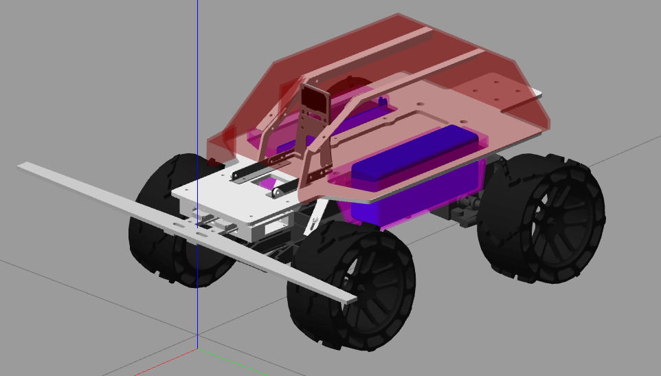
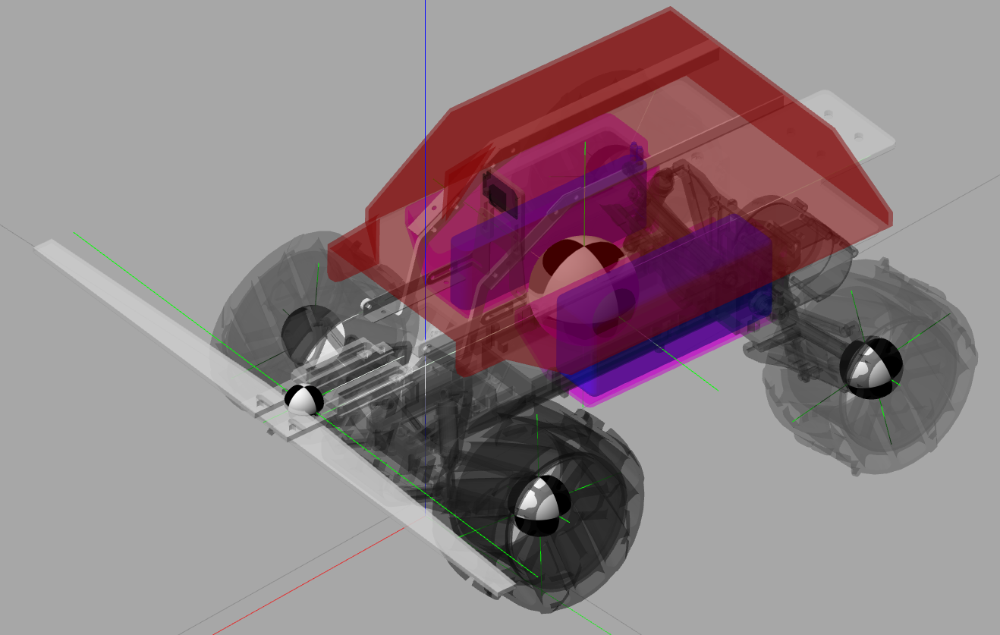
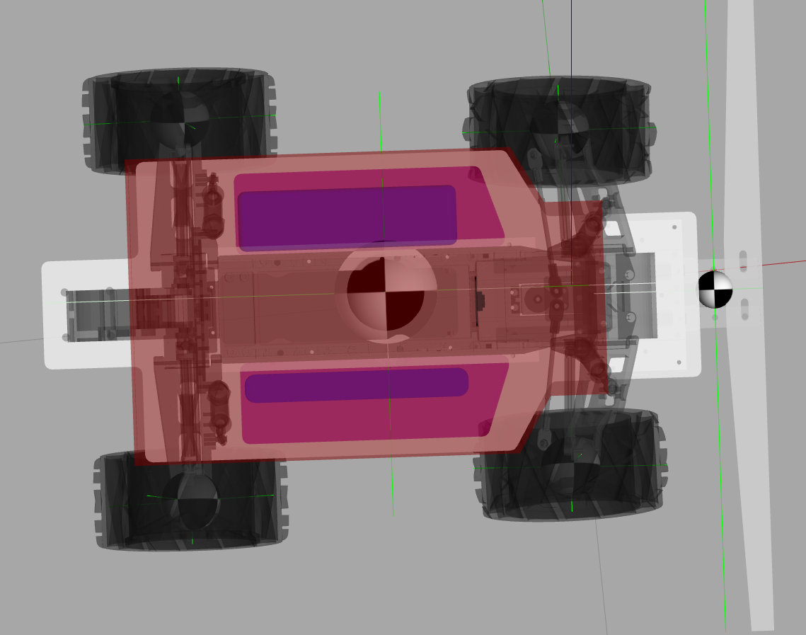

# 🧭 ThunderWaze simulation with Gazebo

Simulation package for Thunderatz's robot ThunderWaze v.4.0, build with [ROS](http://wiki.ros.org/ROS/Introduction) and [Gazebo](http://www.gazebosim.org/tutorials?tut=guided_b1)

## ⏯ Intro

Fork of [vss_simulation](https://github.com/ThundeRatz/vss_simulation)

To run the simulation:

```bash
roslaunch thunderwaze gazebo.launch
```

## 🕹 Control

The simulation receives a [geometry_msgs/Twist](http://docs.ros.org/noetic/api/geometry_msgs/html/msg/Twist.html) describing the robot movement

```c
# This expresses velocity in free space broken into its linear and angular parts.
Vector3  linear
Vector3  angular
```

Future versions should reveice 2 std_msgs/Float64 messages for the motor speed and the servo direction

## Dependencies

To install ROS and Gazebo, use the command:

```bash
sudo apt install ros-noetic-desktop-full
```

The project requires the libraries velocity_controllers and position_controllers inside [ros_controllers](https://github.com/ros-controls/ros_controllers) and the python library [pygame](https://github.com/pygame/pygame). It is possible to install with ```apt-get```

```bash
sudo apt install ros-noetic-position-controllers ros-noetic-velocity-controllers python-pygame
```

Or with ```rosdep```

```bash
rosdep install thunderwaze
```

## 🎨 Gazebo colors

To a complete list of default Gazebo colors, see the oficial repo [material script](https://bitbucket.org/osrf/gazebo/src/gazebo11/media/materials/scripts/gazebo.material).

To create new colors, check the OGRE script inside ./media/materials/scripts

## 📷 Screenshots






