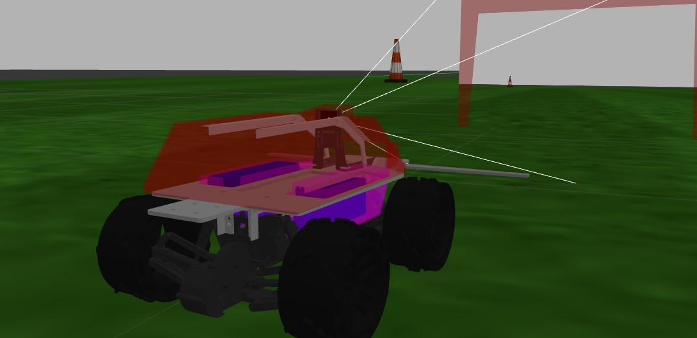
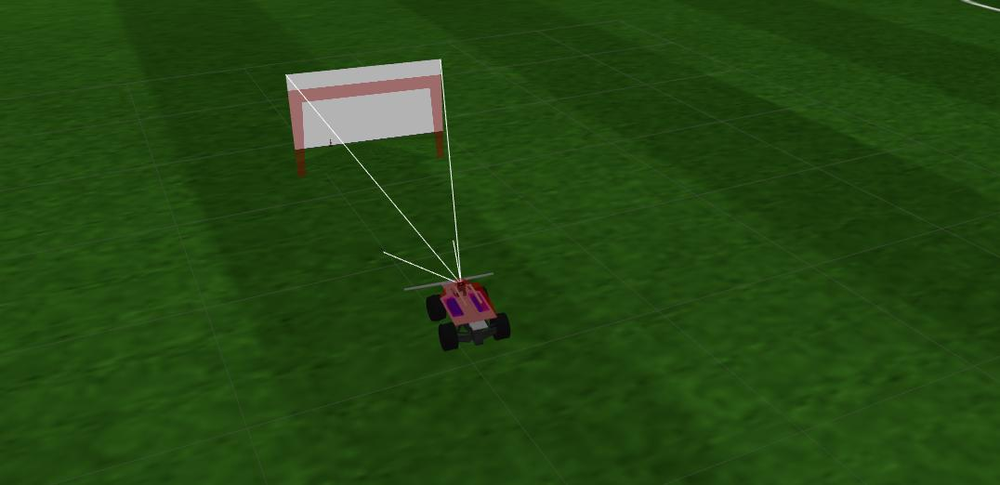
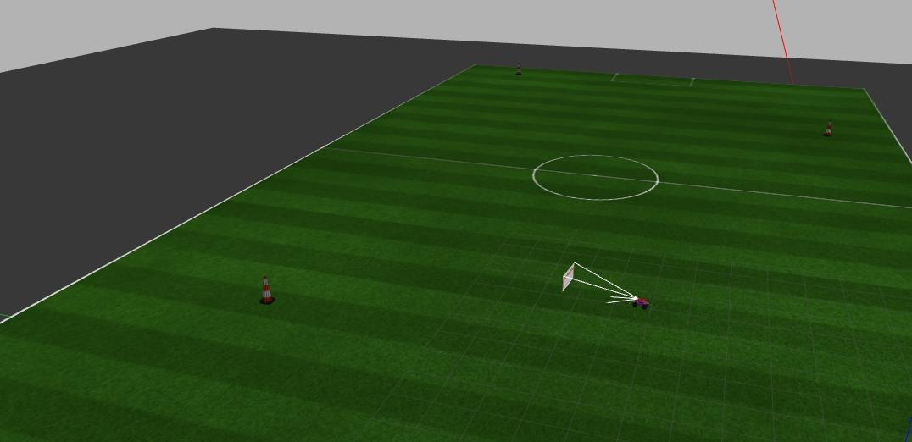
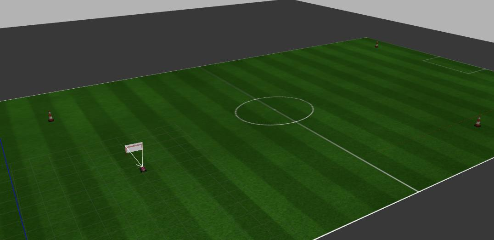

<h1 align="center">
    🧭 Perse simulation with Gazebo
</h1>
<p align="center">

 
<!-- ALL-CONTRIBUTORS-BADGE:START - Do not remove or modify this section -->

<!-- ALL-CONTRIBUTORS-BADGE:END -->
</p>

<p align="center">


</p>

- [⏯ Intro](#-intro)
- [📷 Screenshots](#-screenshots)
- [📁 Folder Structure](#-folder-structure)
- [🎈 Getting started](#-getting-started)
  - [🔨 Compiling](#-compiling)
  - [🚀 Running](#-running)
  - [:memo: Before commiting](#memo-before-commiting)
- [🕹️ Control](#️-control)
  - [🎮 Gazebo controls](#-gazebo-controls)
  - [⌨️ Keyboard](#️-keyboard)
  - [💻 Perse repository](#-perse-repository)
- [🗃️ Dependencies](#️-dependencies)
- [🎨 Gazebo colors](#-gazebo-colors)
- [✨ Contributors](#-contributors)

## ⏯ Intro

Simulation package for Thunderatz's robot [Perse](https://github.com/ThundeRatz/perse/tree/master), build with [ROS](http://wiki.ros.org/ROS/Introduction) and [Gazebo](http://www.gazebosim.org/tutorials?tut=guided_b1). This repository contains the robot and map models.

## 📷 Screenshots

<p align="center">
  
  
  
  
</p>

## 📁 Folder Structure

- **config/** - Simulation variable files, stored in .yaml
- **docs/** - Image files used in the README.
- **include/** - Header files.
- **launch/** - Launch files.
- **media/materials/scripts/** - Perse's material script files.
- **meshes/** - .STL Perse files.
- **models/** - Objects model folder.
- **scripts/** - Python executable files.
- **src/** - Executables source code.
- **urdf/** - Perse's model files.
- **worlds/** - .world files.

## 🎈 Getting started

### 🔨 Compiling

To compile the project, you can use `catkin build` that It's a better version from the `catkin_make` because it builds different packages in parallel, making it faster; It also has a more colorful and easily-readable terminal when building; And it provides extra commands, such as `catkin clean`.

To use it, you have to install python catkin packages:

```bash
sudo apt-get install python3-catkin-tools
```

Now you can run the folowing command in the current catkin workspace root:

```bash
catkin build
```

Alternatively, you can use the default option:

```bash
catkin_make
```

### 🚀 Running

To start the simulation, run the following command:

```bash
roslaunch perse_simulation gazebo.launch
```

### :memo: Before commiting

This code has [Uncrustify](http://uncrustify.sourceforge.net/) implemented. So, before pushing any commits, please, run the following command to format the code:

```bash
./format.sh
```

## 🕹️ Control

There are 3 ways for you to controll the robot.

### 🎮 Gazebo controls

The gazebo simulation has it's own controls which allows you to change the linear and angular velocity of the robot. It starts along the simulation launch.

### ⌨️ Keyboard


You can control the robot by the keyboard running the following command:
```bash
python3 scrips/keyboard_controller.py
```

### 💻 Perse repository

The [Perse](https://github.com/ThundeRatz/perse/tree/master) repository has it's own launcher that allows the robot to run by itself. To start the main control node, which uses odometry (IMU + Encoder) to reach the 3 points, run the folowing command:

```bash
roslaunch perse odometry.launch
```
You can find more details [here](https://github.com/ThundeRatz/perse/tree/master#-running)

## 🗃️ Dependencies

To install ROS and Gazebo, use the command:

```bash
sudo apt install ros-noetic-desktop-full
```

The project requires the libraries velocity_controllers and position_controllers inside [ros_controllers](https://github.com/ros-controls/ros_controllers) and the python library [pygame](https://github.com/pygame/pygame). It is possible to install with ```apt-get```

```bash
sudo apt install ros-noetic-position-controllers ros-noetic-velocity-controllers python-pygame
```

Or with ```rosdep```

```bash
rosdep install perse_simulation
```

## 🎨 Gazebo colors

To a complete list of default Gazebo colors, see the oficial repo [material script](https://bitbucket.org/osrf/gazebo/src/gazebo11/media/materials/scripts/gazebo.material).

To create new colors, check the OGRE script inside ./media/materials/scripts

## ✨ Contributors

Thanks goes to these wonderful people ([emoji key](https://allcontributors.org/docs/en/emoji-key)):

<!-- ALL-CONTRIBUTORS-LIST:START - Do not remove or modify this section -->
<!-- prettier-ignore-start -->
<!-- markdownlint-disable -->
<table>
  <tr>
    <td align="center"><a href="https://github.com/DamaralHenrique"><br /><sub><b>Henrique D`Amaral</b></sub></a><br /><a href="https://github.com/ThundeRatz/perse_simulation/commits/develop?author=DamaralHenrique" title="Code">💻</a> <a href="https://github.com/ThundeRatz/perse_simulation/commits/develop?author=DamaralHenrique" title="Documentation">📖</a> <a href="https://github.com/ThundeRatz/perse_simulation/pulls?q=is%3Apr+reviewed-by%3ADamaralHenrique" title="Reviewed Pull Requests">👀</a> <a href="https://github.com/ThundeRatz/perse_simulation/tree/develop/meshes" title="Modeling">🎨</a></td>
    <td align="center"><a href="https://github.com/mariarezende07"><br /><sub><b>Maria Fernanda Rezende</b></sub></a><br /><a href="https://github.com/ThundeRatz/perse_simulation/commits/develop?author=mariarezende07" title="Code">💻</a> <a href="https://github.com/ThundeRatz/perse_simulation/commits/develop?author=mariarezende07" title="Documentation">📖</a> <a href="https://github.com/ThundeRatz/perse_simulation/pulls?q=is%3Apr+reviewed-by%3Amariarezende07" title="Reviewed Pull Requests">👀</a></td>
    <td align="center"><a href="https://github.com/guedeslucas1"><br /><sub><b>Lucas Guedes</b></sub></a><br /><a href="https://github.com/ThundeRatz/perse_simulation/commits/develop?author=guedeslucas1" title="Code">💻</a> <a href="https://github.com/ThundeRatz/perse_simulation/commits/develop?author=guedeslucas1" title="Documentation">📖</a> <a href="https://github.com/ThundeRatz/perse_simulation/pulls?q=is%3Apr+reviewed-by%3Aguedeslucas1" title="Reviewed Pull Requests">👀</a></td>
    <td align="center"><a href="https://github.com/FelipeGdM"><br /><sub><b>Felipe Gomes de Melo</b></sub></a><br /><a href="https://github.com/ThundeRatz/perse_simulation/commits/develop?author=FelipeGdM" title="Code">💻</a> <a href="https://github.com/ThundeRatz/perse_simulation/pulls?q=is%3Apr+reviewed-by%3AFelipeGdM" title="Reviewed Pull Requests">👀</a> <a href="#ideas-FelipeGdM" title="Ideas, Planning, & Feedback">🤔</a> <a href="https://github.com/ThundeRatz/perse_simulation/tree/develop/meshes" title="Modeling">🎨</a></td>
    <td align="center"><a href="https://github.com/febagni"><br /><sub><b>Felipe Bagni</b></sub></a><br /><a href="https://github.com/ThundeRatz/perse_simulation/pulls?q=is%3Apr+reviewed-by%3Afebagni" title="Reviewed Pull Requests">👀</a></td>
    <td align="center"><a href="https://github.com/d-nery"><br /><sub><b>Daniel Nery</b></sub></a><br /><a href="https://github.com/ThundeRatz/perse_simulation/pulls?q=is%3Apr+reviewed-by%3Ad-nery" title="Reviewed Pull Requests">👀</a></td>
  </tr>
  <tr>
    <td align="center"><a href="https://github.com/Tocoquinho"><br /><sub><b>Tocoquinho</b></sub></a><br /><a href="https://github.com/ThundeRatz/perse_simulation/commits/develop?author=Tocoquinho" title="Code">💻</a> <a href="https://github.com/ThundeRatz/perse_simulation/commits/develop?author=Tocoquinho" title="Documentation">📖</a> <a href="https://github.com/ThundeRatz/perse_simulation/pulls?q=is%3Apr+reviewed-by%3ATocoquinho" title="Reviewed Pull Requests">👀</a> <a href="#ideas-Tocoquinho" title="Ideas, Planning, & Feedback">🤔</a></td>
    <td align="center"><a href="https://github.com/lucastrschneider"><br /><sub><b>Lucas Schneider</b></sub></a><br /><a href="https://github.com/ThundeRatz/perse_simulation/tree/develop/meshes" title="Modeling">🎨</a></td>
    <td align="center"><a href="https://github.com/LucasHaug"><br /><sub><b>Lucas Haug</b></sub></a><br /><a href="https://github.com/ThundeRatz/perse_simulation/pulls?q=is%3Apr+reviewed-by%3ALucasHaug" title="Reviewed Pull Requests">👀</a></td>
  </tr>
</table>

<!-- markdownlint-restore -->
<!-- prettier-ignore-end -->

<!-- ALL-CONTRIBUTORS-LIST:END -->

Click on the emojis to get more info on the member contribution!

This project follows the [all-contributors](https://github.com/all-contributors/all-contributors) specification. Contributions of any kind welcome!
